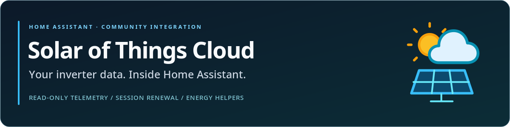

# Solar of Things Cloud — integrazione Home Assistant

[](https://github.com/redhunt07/ha-solar-of-things-cloud/actions/workflows/ci.yml) [](https://github.com/redhunt07/ha-solar-of-things-cloud/actions/workflows/validate.yml) [](https://my.home-assistant.io/redirect/hacs_repository/?owner=redhunt07&repository=ha-solar-of-things-cloud&category=integration) [](https://github.com/redhunt07/ha-solar-of-things-cloud/releases/latest) [](https://www.home-assistant.io/) [](LICENSE)

Maintainer: **[RedHunt07](https://github.com/redhunt07)** · [English](README.md) · [Italiano](README.it.md)



[Scarica lo ZIP aggiornato](https://github.com/redhunt07/ha-solar-of-things-cloud/releases/latest) · [Segnala un problema](https://github.com/redhunt07/ha-solar-of-things-cloud/issues/new/choose) · [Contribuisci](CONTRIBUTING.md)


Integrazione **in sola lettura** per la telemetria cloud degli inverter **Solar of Things** (Siseli). Espone le misure che l'app del fornitore già decodifica — batteria, rete, fotovoltaico, carichi e temperatura inverter — e rinnova automaticamente la sessione cloud quando è disponibile un refresh token.

Nessun dato viene scritto sull'inverter: nessuna impostazione, modalità o aggiornamento firmware.

> **Perimetro.** L'integrazione usa il cloud del fornitore (`solar.siseli.com`). Non è un'integrazione BLE/Modbus locale e non sostituisce quella ufficiale. Verificata su Home Assistant **2026.10.4** con un inverter reale e **18 entità in sola lettura**.

## Cosa offre

| Funzione | Dettaglio |
| :--- | :--- |
| Telemetria in sola lettura | 18 sensori numerici decodificati dal cloud, unità originali |
| Rinnovo automatico della sessione | Refresh 5 minuti prima della scadenza, un solo retry, token ruotati salvati |
| Riautenticazione | Inserimento di una nuova coppia di token se il refresh viene revocato o scade |
| Controlli sui dati | Campioni vecchi, timestamp futuri, unità errate, campi nascosti e valori non numerici vengono rifiutati invece di diventare zeri |
| Diagnostica | Scaricabile, con i token rimossi |
| Nessuna scrittura | Solo `GET /deviceState/simple/state/latest/v1` e `POST /login/refresh/access/token` |

Il polling è fisso a **60 secondi**. Il cloud aggiorna le misure circa ogni 5 minuti, quindi è sufficiente senza sovraccaricare il servizio.

## Requisiti

- Home Assistant **2026.10 o successivo** (testato su 2026.10.4).
- Un account Solar of Things con almeno un inverter visibile nell'app.
- L'**ID numerico del dispositivo** e una **sessione esistente** (token di accesso e, consigliato, refresh token).
- Accesso HTTPS in uscita verso `solar.siseli.com`.

Non servono pacchetti Python aggiuntivi: `aiohttp` e `cryptography` sono già inclusi in Home Assistant.

## Installazione

### HACS (consigliata)

1. Apri **HACS → Integrazioni**.
2. Menu a tre punti → **Repository personalizzati**.
3. Aggiungi `https://github.com/redhunt07/ha-solar-of-things-cloud` con categoria **Integration**.
4. Cerca **Solar of Things Cloud**, scarica e riavvia Home Assistant.
5. Vai in **Impostazioni → Dispositivi e servizi → Aggiungi integrazione → Solar of Things Cloud**.

[](https://my.home-assistant.io/redirect/hacs_repository/?owner=redhunt07&repository=ha-solar-of-things-cloud&category=integration)

### Manuale

1. Copia `custom_components/solar_of_things_cloud` in `/config/custom_components/`.
2. Riavvia Home Assistant.
3. Aggiungi l'integrazione da **Impostazioni → Dispositivi e servizi**.

L'integrazione non è nel catalogo HACS predefinito: va aggiunta come repository personalizzato.

## Configurazione

Campi richiesti:

| Campo | Obbligatorio | Descrizione |
| :--- | :--- | :--- |
| **ID dispositivo** | Sì | ID numerico inverter/stazione usato dall'API del fornitore |
| **Token di accesso** | Sì | `IOT-Token` della sessione autenticata |
| **Refresh token** | Consigliato | Abilita il rinnovo automatico; senza, la sessione scade in poche ore e serve riauntenticare |

Il modulo chiede solo i valori che inserisci: non legge mai le credenziali salvate da un'altra integrazione.

La password dell'account non viene mai richiesta né salvata.

## Ottenere ID e token

L'app non mostra i token nell'interfaccia. Copiali dalla tua sessione nell'app: conserva token di accesso, refresh token e scadenza nel proprio archivio locale. Sono credenziali: non incollarli nelle issue o negli screenshot.

L'ID dispositivo è l'identificativo numerico dell'inverter, non il seriale stampato sull'etichetta: è lo stesso valore che l'app usa come `deviceId`.

> Il token di accesso dura circa due ore. Il refresh token dura molto di più (circa 30 giorni) e viene ruotato a ogni rinnovo. Se Home Assistant lo ruota, un secondo client che conserva il vecchio refresh token potrebbe dover riaccedere.

## Rinnovo della sessione

L'integrazione riproduce la richiesta di rinnovo dell'app:

1. Una risposta `401`/`403` o un `code: 9` applicativo ("token expired") indicano sessione scaduta.
2. Access token e refresh token vengono inviati a `/apis/login/refresh/access/token` con le intestazioni firmate del portale.
3. La nuova coppia e le scadenze vengono salvate nella config entry **prima** di qualsiasi altra richiesta.
4. Aggiornamenti concorrenti condividono un solo rinnovo; la lettura viene ritentata al massimo una volta.
5. Se il refresh token viene rifiutato, l'entry richiede la riaautenticazione e Home Assistant mostra il modulo dedicato.

La firma usa l'identità pubblica del portale web, verificata sull'endpoint reale. Non servono la password dell'account né l'identità privata dell'app mobile.

## Entità

Tutte le entità appartengono al dispositivo **Inverter cloud sola lettura** e sono in sola lettura. Gli ID sono stabili per le installazioni esistenti; la tabella mostra quelli predefiniti.

| Entità | Misura | Unità | Classe |
| :--- | :--- | :--- | :--- |
| `sensor.inverter_cloud_sola_lettura_battery_voltage` | Tensione batteria | V | voltage |
| `sensor.inverter_cloud_sola_lettura_battery_capacity_inverter_estimate` | Capacità batteria (stima inverter) | % | battery |
| `sensor.inverter_cloud_sola_lettura_battery_charging_current` | Corrente di carica | A | current |
| `sensor.inverter_cloud_sola_lettura_battery_discharge_current` | Corrente di scarica | A | current |
| `sensor.inverter_cloud_sola_lettura_grid_voltage` | Tensione rete | V | voltage |
| `sensor.inverter_cloud_sola_lettura_grid_frequency` | Frequenza rete | Hz | frequency |
| `sensor.inverter_cloud_sola_lettura_grid_power` | Potenza rete | kW | power |
| `sensor.inverter_cloud_sola_lettura_output_voltage` | Tensione uscita | V | voltage |
| `sensor.inverter_cloud_sola_lettura_output_frequency` | Frequenza uscita | Hz | frequency |
| `sensor.inverter_cloud_sola_lettura_load_power` | Potenza carichi | kW | power |
| `sensor.inverter_cloud_sola_lettura_load_percentage` | Percentuale carico | % | — |
| `sensor.inverter_cloud_sola_lettura_pv_generation_power` | Potenza generazione FV | kW | power |
| `sensor.inverter_cloud_sola_lettura_pv_voltage` | Tensione FV | V | voltage |
| `sensor.inverter_cloud_sola_lettura_pv_current` | Corrente FV | A | current |
| `sensor.inverter_cloud_sola_lettura_pv_power` | Potenza FV | kW | power |
| `sensor.inverter_cloud_sola_lettura_pv_energy_today` | Energia FV oggi | kWh | energy |
| `sensor.inverter_cloud_sola_lettura_pv_energy_total` | Energia FV totale | kWh | energy |
| `sensor.inverter_cloud_sola_lettura_inverter_temperature` | Temperatura inverter | °C | temperature |

Ogni sensore espone due attributi:

- `source_time` — quando il cloud ha acquisito il campione, non quando Home Assistant lo ha scaricato.
- `source` — sempre `vendor_cloud`.

I sensori energia usano la classe conservativa `total`, non `total_increasing`: reset e correzioni del fornitore non sono dati per scontati come monotoni.

## Dashboard Energia

L'integrazione include un package opzionale, [`examples/sot_cloud_energy.yaml`](examples/sot_cloud_energy.yaml), che:

- converte le potenze da kW a W;
- calcola carica/scarica batteria come `V × A` lato DC;
- integra le potenze in contatori kWh stimati;
- aggiunge contatori giornalieri, mensili e annuali per rete, FV, carichi e batteria.

Copia il file in `/config/packages/`, abilita `packages:` in `configuration.yaml` e riavvia Home Assistant. Poi aggiungi i contatori `sot_*` in **Impostazioni → Dashboard → Energia**.

Attenzione: sono **stime**. I campioni cloud arrivano circa ogni 5 minuti, la potenza batteria è misurata prima delle perdite dell'inverter e il valore di rete riguarda l'ingresso dell'inverter, non necessariamente tutta la casa. L'unico contatore energia fornito dal vendor è il totale FV.

## Risoluzione dei problemi

| Sintomo | Significato | Azione |
| :--- | :--- | :--- |
| `invalid_auth` in configurazione | Sessione scaduta, revocata o token errato | Recupera una coppia di token nuova e riprova |
| `cannot_connect` | Cloud irraggiungibile, ID errato o campione vecchio | Controlla connettività, ID e stato dell'inverter nell'app |
| Entità non disponibili | Sessione scaduta senza refresh token, o disservizio cloud | Usa la riaautenticazione; controlla l'app |
| La riaautenticazione fallisce | Refresh token revocato o ruotato altrove | Accedi di nuovo nell'app e copia una coppia nuova |
| `code: 9` nei log | Sessione vendor scaduta | Atteso una volta; il rinnovo è automatico se c'è un refresh token |

Log di debug, solo se necessario:

```yaml
logger:
  logs:
    custom_components.solar_of_things_cloud: debug
```

L'integrazione non registra mai token, URL con query string o corpi delle risposte.

## Privacy e sicurezza

- I token stanno nella config entry di Home Assistant. Proteggi `/config/.storage` e i backup.
- La diagnostica è redatta: solo ID dispositivo, scadenze e misure — mai i token.
- Le richieste vanno esclusivamente all'origine fissa del fornitore; i redirect non vengono seguiti e nessun URL esterno è accettato.
- L'integrazione è in sola lettura: nessun endpoint di comando, modalità o firmware.
- La richiesta di refresh contiene access token, refresh token e la firma pubblica del portale. Nessuna password viene inviata.

Problema di sicurezza? Apri una **security advisory privata** su GitHub invece di una issue pubblica. Vedi [SECURITY.md](SECURITY.md).

## Limiti

- **Dipendenza dal cloud.** Se il servizio del fornitore o la connessione cadono, la telemetria si ferma. Non c'è fallback locale.
- **Latenza del fornitore.** I campioni hanno tipicamente circa 5 minuti; `source_time` lo rende esplicito.
- **Sola lettura.** Impostazioni e modalità dell'inverter non sono esposte né modificate.
- **Stime, non contatori fiscali.** La capacità batteria è la stima dell'inverter, non una lettura BMS indipendente. I contatori energia sono integrali stimati.
- **Perimetro rete.** `grid_power` è ciò che vede l'inverter; non copre necessariamente l'intero impianto.
- **Reset energia.** Il totale del fornitore è usato così com'è; reset e correzioni non sono dati per monotoni.
- **Gestione token.** Senza refresh token la sessione scade in poche ore e serve la riaautenticazione.

## Sviluppo

```sh
python3 -m unittest discover -s tests -t . -v   # 23 test offline
ruff check . && ruff format --check .
```

La suite gira senza Home Assistant: verifica parser e rinnovo sessione con un fixture reale sanificato e un cloud finto. La CI esegue anche `hassfest` e la validazione HACS.

Contributi benvenuti — vedi [CONTRIBUTING.md](CONTRIBUTING.md). Includi versione di Home Assistant, versione dell'integrazione e log redatti.

## Licenza

MIT — vedi [LICENSE](LICENSE). Documentazione in inglese: [README.md](README.md).

Integrazione indipendente della community, non affiliata a Solar of Things o Siseli.
