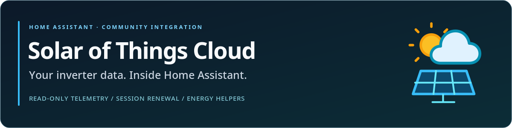

# Solar of Things Cloud — Home Assistant integration

[](https://github.com/redhunt07/ha-solar-of-things-cloud/actions/workflows/ci.yml) [](https://github.com/redhunt07/ha-solar-of-things-cloud/actions/workflows/validate.yml) [](https://my.home-assistant.io/redirect/hacs_repository/?owner=redhunt07&repository=ha-solar-of-things-cloud&category=integration) [](https://github.com/redhunt07/ha-solar-of-things-cloud/releases/latest) [](https://www.home-assistant.io/) [](LICENSE)

Maintainer: **[RedHunt07](https://github.com/redhunt07)** · [English](README.md) · [Italiano](README.it.md)



[Download the latest ZIP](https://github.com/redhunt07/ha-solar-of-things-cloud/releases/latest) · [Report a bug](https://github.com/redhunt07/ha-solar-of-things-cloud/issues/new/choose) · [Contribute](CONTRIBUTING.md)


Read-only Home Assistant integration for **Solar of Things** (Siseli) inverter cloud telemetry. It exposes the measurements the vendor app already decodes — battery, grid, PV, load and inverter temperature — and renews the cloud session automatically when a refresh token is available.

Nothing is written back to the inverter: no settings, no modes, no firmware updates.

> **Scope.** This integration talks to the vendor cloud (`solar.siseli.com`). It is not a local BLE/Modbus integration and does not replace the official one. Verified against Home Assistant **2026.10.4** on a live inverter, with **18 read-only entities**.

## Contents

- [What you get](#what-you-get)
- [Requirements](#requirements)
- [Installation](#installation)
- [Configuration](#configuration)
- [Obtaining the device ID and tokens](#obtaining-the-device-id-and-tokens)
- [Session renewal](#session-renewal)
- [Entities](#entities)
- [Energy dashboard](#energy-dashboard)
- [Troubleshooting](#troubleshooting)
- [Privacy and security](#privacy-and-security)
- [Limitations](#limitations)
- [Development](#development)
- [License](#license)

## What you get

| Capability | Detail |
| :--- | :--- |
| Read-only telemetry | 18 numeric sensors decoded from the vendor cloud, units preserved |
| Automatic session renewal | Proactive refresh 5 minutes before expiry, one bounded retry, rotated tokens persisted |
| Reauthentication flow | Paste a fresh token pair when the refresh token is revoked or expired |
| Data quality guards | Stale samples, future timestamps, wrong units, hidden fields and non-numeric values are rejected instead of shown as zeros |
| Diagnostics | Downloadable diagnostics with tokens removed |
| No writes | Only `GET /deviceState/simple/state/latest/v1` and `POST /login/refresh/access/token` |

Polling is fixed at **60 seconds**. The vendor cloud typically updates measurements about every 5 minutes, so a 60-second poll is enough to catch new samples without hammering the service.

## Requirements

- Home Assistant **2026.10 or newer** (tested on 2026.10.4).
- A Solar of Things account and at least one inverter visible in the vendor app.
- The numeric **device ID** and an existing **session token** (access token and, ideally, the matching refresh token).
- Outbound HTTPS access to `solar.siseli.com`.

No extra Python packages are required: `aiohttp` and `cryptography` are already part of Home Assistant.

## Installation

### HACS (recommended)

1. Open **HACS → Integrations**.
2. Open the three-dot menu → **Custom repositories**.
3. Add `https://github.com/redhunt07/ha-solar-of-things-cloud` with category **Integration**.
4. Search for **Solar of Things Cloud**, download it and restart Home Assistant.
5. Go to **Settings → Devices & services → Add integration → Solar of Things Cloud**.

[](https://my.home-assistant.io/redirect/hacs_repository/?owner=redhunt07&repository=ha-solar-of-things-cloud&category=integration)

### Manual

1. Copy `custom_components/solar_of_things_cloud` into your Home Assistant `/config/custom_components/` directory.
2. Restart Home Assistant.
3. Add the integration from **Settings → Devices & services**.

The integration is not in the default HACS store; it is installed as a custom repository.

## Configuration

The setup form asks for:

| Field | Required | Description |
| :--- | :--- | :--- |
| **Device ID** | Yes | Numeric inverter/station ID used by the vendor API |
| **Access token** | Yes | Existing `IOT-Token` from your authenticated session |
| **Refresh token** | Recommended | Enables automatic renewal; without it the session expires after a few hours and needs reauthentication |

The form only asks for the values you enter; it never reads credentials stored by another integration.

Your account password is never requested and never stored.

## Obtaining the device ID and tokens

The vendor app does not display tokens in its UI. Copy them from your own app session: the app keeps the access token, refresh token and expiry in its local session store. Tokens are credentials: do not paste them into issues or screenshots.

The device ID is the numeric identifier of your inverter, not the serial number printed on the label. It is the same value the vendor app uses for `deviceId` requests.

> A session token is short-lived (about two hours). The refresh token lasts much longer (about 30 days) and is rotated on every renewal. If Home Assistant rotates it, a second client that kept the old refresh token may need to sign in again.

## Session renewal

The integration reproduces the renewal request the vendor app performs:

1. A `401`/`403` response or an application `code: 9` ("token expired") is treated as an expired session.
2. The access token and refresh token are posted to `/apis/login/refresh/access/token` with the signed portal headers.
3. The new token pair and expiries are saved in the config entry **before** any further telemetry request.
4. Concurrent updates share a single renewal; the telemetry read is retried at most once.
5. If the refresh token is rejected, the entry raises a reauthentication request and Home Assistant shows the reauth form.

The signature uses the public web-portal application identity. It was verified against the real endpoint; the account password and the mobile app's private identity are not needed.

## Entities

All entities belong to the device **Inverter cloud sola lettura** and are read-only. Entity IDs are stable for existing installations; the table below shows the default IDs.

| Entity ID | Measurement | Unit | Device class |
| :--- | :--- | :--- | :--- |
| `sensor.inverter_cloud_sola_lettura_battery_voltage` | Battery voltage | V | voltage |
| `sensor.inverter_cloud_sola_lettura_battery_capacity_inverter_estimate` | Battery capacity (inverter estimate) | % | battery |
| `sensor.inverter_cloud_sola_lettura_battery_charging_current` | Battery charging current | A | current |
| `sensor.inverter_cloud_sola_lettura_battery_discharge_current` | Battery discharge current | A | current |
| `sensor.inverter_cloud_sola_lettura_grid_voltage` | Grid voltage | V | voltage |
| `sensor.inverter_cloud_sola_lettura_grid_frequency` | Grid frequency | Hz | frequency |
| `sensor.inverter_cloud_sola_lettura_grid_power` | Grid power | kW | power |
| `sensor.inverter_cloud_sola_lettura_output_voltage` | Output voltage | V | voltage |
| `sensor.inverter_cloud_sola_lettura_output_frequency` | Output frequency | Hz | frequency |
| `sensor.inverter_cloud_sola_lettura_load_power` | Load power | kW | power |
| `sensor.inverter_cloud_sola_lettura_load_percentage` | Load percentage | % | — |
| `sensor.inverter_cloud_sola_lettura_pv_generation_power` | PV generation power | kW | power |
| `sensor.inverter_cloud_sola_lettura_pv_voltage` | PV voltage | V | voltage |
| `sensor.inverter_cloud_sola_lettura_pv_current` | PV current | A | current |
| `sensor.inverter_cloud_sola_lettura_pv_power` | PV power | kW | power |
| `sensor.inverter_cloud_sola_lettura_pv_energy_today` | PV energy today | kWh | energy |
| `sensor.inverter_cloud_sola_lettura_pv_energy_total` | PV energy total | kWh | energy |
| `sensor.inverter_cloud_sola_lettura_inverter_temperature` | Inverter temperature | °C | temperature |

Each sensor exposes two attributes:

- `source_time` — when the vendor cloud acquired the sample, not when Home Assistant fetched it.
- `source` — always `vendor_cloud`.

Energy sensors use the conservative `total` state class, not `total_increasing`: resets and corrections by the vendor are not assumed to be monotonic.

## Energy dashboard

The integration ships an optional package, [`examples/sot_cloud_energy.yaml`](examples/sot_cloud_energy.yaml), that:

- converts the kW power sensors to W;
- computes battery charge/discharge power as `V × A` on the DC side;
- integrates power into estimated kWh counters;
- adds day/month/year utility meters for grid, PV, load and battery.

Copy it to `/config/packages/`, make sure `packages:` is enabled in `configuration.yaml`, and restart Home Assistant. Then add the resulting `sot_*` counters to **Settings → Dashboards → Energy**.

Important: these are **estimates**. Cloud samples arrive roughly every 5 minutes, battery power is measured before inverter losses, and the grid value covers the inverter input, not necessarily the whole house. The only vendor-provided energy counter is the PV total.

## Troubleshooting

| Symptom | Meaning | Action |
| :--- | :--- | :--- |
| `invalid_auth` during setup | Session expired, revoked or wrong token | Get a fresh token pair from the app and retry |
| `cannot_connect` | Cloud unreachable, device ID wrong, or sample stale | Check connectivity, device ID and that the inverter is online in the app |
| Entities become unavailable | Session expired and no refresh token, or cloud outage | Use the reauth flow; check the vendor app |
| Reauth keeps failing | Refresh token revoked or rotated elsewhere | Sign in again in the app and copy a new pair |
| `code: 9` in logs | Vendor session expired | Expected once; the integration renews automatically if a refresh token is stored |

Enable debug logging only when needed:

```yaml
logger:
  logs:
    custom_components.solar_of_things_cloud: debug
```

The integration never logs tokens, URLs with query strings or response bodies.

## Privacy and security

- Tokens live in the Home Assistant config entry. Protect `/config/.storage` and your backups.
- Diagnostics are redacted: device ID, expiries and measurements only — never the tokens.
- Requests go exclusively to the fixed vendor origin; redirects are not followed and no caller-supplied URL is accepted.
- The integration is read-only: no command, mode or firmware endpoint is called.
- The refresh request contains the access token, the refresh token and the public portal application signature. No password is sent.

Found a security issue? Please open a **private security advisory** on GitHub instead of a public issue. See [SECURITY.md](SECURITY.md).

## Limitations

- **Cloud dependency.** If the vendor service or your internet connection is down, telemetry stops. There is no local fallback in this integration.
- **Vendor latency.** Samples are typically about 5 minutes old; `source_time` makes this explicit.
- **Read-only.** Inverter settings and modes are not exposed or changed.
- **Estimates, not meters.** Battery capacity is the inverter's own estimate, not an independent BMS reading. Energy counters are integrated estimates.
- **Grid scope.** `grid_power` is what the inverter sees; it does not necessarily cover the whole installation.
- **Energy resets.** The vendor total is used as-is; resets and corrections are not claimed to be monotonic.
- **Token handling.** Without a refresh token, sessions expire after a few hours and require the reauth flow.

## Development

```sh
python3 -m unittest discover -s tests -t . -v   # 23 offline tests
ruff check . && ruff format --check .
```

The test suite runs without Home Assistant: it exercises the parser and the session renewal with a sanitized real telemetry fixture and a fake cloud. CI also runs `hassfest` and the HACS validation action.

```
custom_components/solar_of_things_cloud/
├── __init__.py        # config entry setup and coordinator
├── api.py             # read-only client and parser
├── auth.py            # signed session renewal
├── config_flow.py     # setup and reauthentication
├── const.py           # endpoint, constants, sensor descriptions
├── diagnostics.py     # redacted diagnostics
├── manifest.json
├── sensor.py
└── translations/      # English and Italian UI strings
```

Contributions are welcome — see [CONTRIBUTING.md](CONTRIBUTING.md). Please include the Home Assistant version, the integration version and redacted logs.

## License

MIT — see [LICENSE](LICENSE). Italian documentation: [README.it.md](README.it.md).

Independent community integration; not affiliated with Solar of Things or Siseli.
