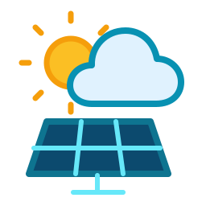

# Solar of Things Cloud for Home Assistant

Read-only cloud telemetry for Solar of Things (Siseli) inverters: battery, grid, PV, load and inverter temperature, with automatic session renewal when a refresh token is available.

- **18 read-only sensors**, units preserved.
- **Session renewal** before expiry, one bounded retry, rotated tokens persisted.
- **Reauthentication flow** when the refresh token is revoked.
- **Data quality guards**: stale samples, wrong units and non-numeric values are rejected, never shown as zeros.
- **No writes** to the inverter.

## Installation

1. HACS → Integrations → three-dot menu → **Custom repositories**.
2. Add `https://github.com/redhunt07/ha-solar-of-things-cloud` as **Integration**.
3. Install **Solar of Things Cloud** and restart Home Assistant.
4. Settings → Devices & services → Add integration → **Solar of Things Cloud**.

Then provide the numeric device ID and a session token from your own app. A refresh token enables automatic renewal. If the official Solar of Things integration is installed, the form prefills its credentials and revalidates them before saving.

Requires Home Assistant 2026.10 or newer. No extra Python packages.

Optional Energy dashboard package: [`examples/sot_cloud_energy.yaml`](examples/sot_cloud_energy.yaml).

Full documentation: [README.md](README.md) · [Italiano](README.it.md). MIT licensed.
